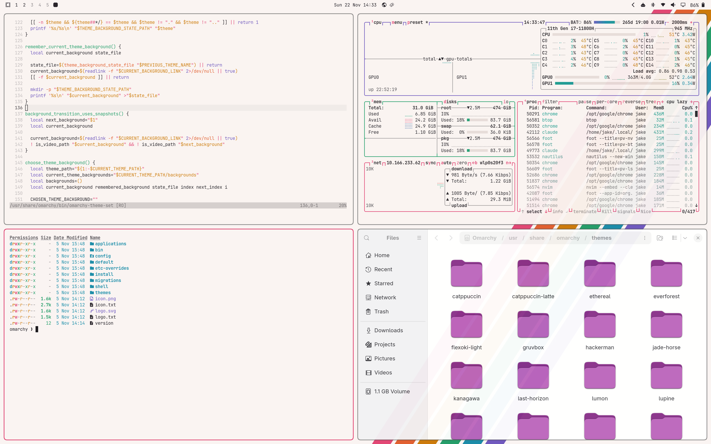

# Monokai Gradient Light

A light Monokai theme for [Omarchy](https://omarchy.org), based on the Monokai Pro Light colours, with a gradient window border and original wallpapers.



## Install

```bash
omarchy theme install https://github.com/jaapie/omarchy-monokai-gradient-light-theme
```

Then pick **Monokai Gradient Light** in the theme switcher, or run `omarchy theme set monokai-gradient-light`.

## What's included

- **Gradient border:** the focused window has a pink → cyan → green border at 45°.
- **Wallpapers:** two original backgrounds, *Stripes* and *Glow*.
- **Neovim:** uses [monokai-pro.nvim](https://github.com/loctvl842/monokai-pro.nvim) (light filter).

## See also

[Monokai Gradient](https://github.com/jaapie/omarchy-monokai-gradient-theme), the dark version.

## Licence

MIT
